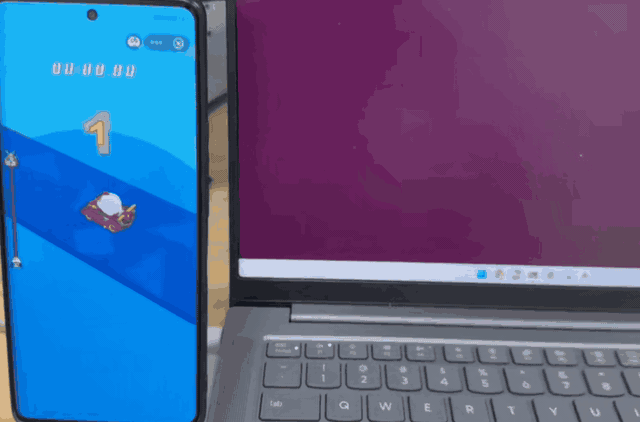
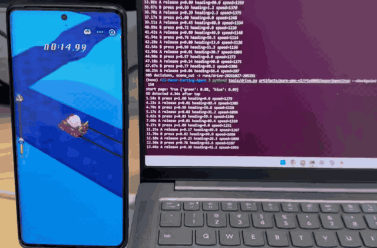
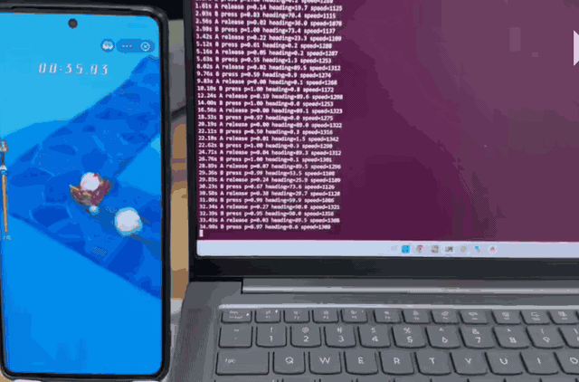
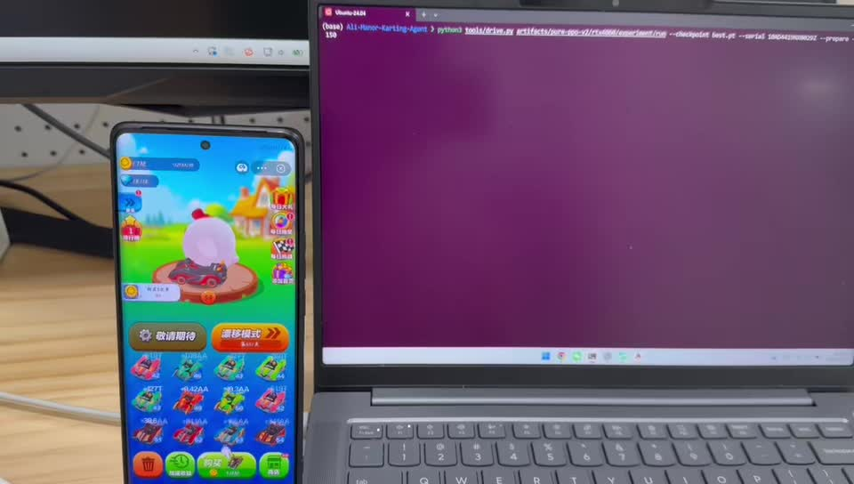
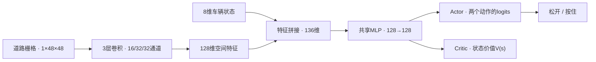
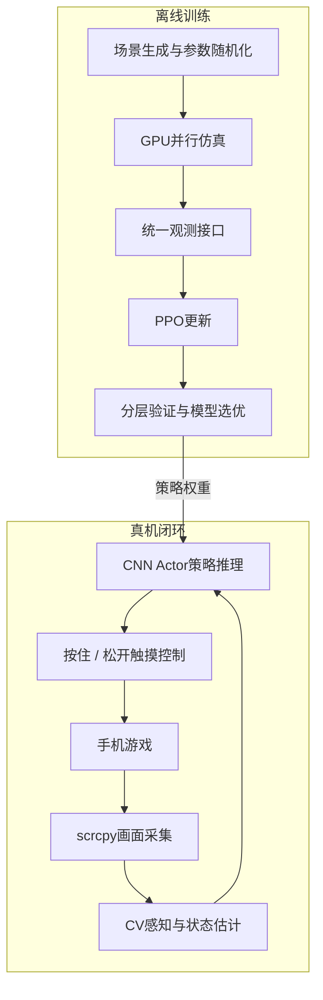

# Ali-Manor Karting Agent

将手机游戏转化为实时视觉控制任务：通过传统计算机视觉构建局部道路表示，使用轻量 CNN Actor-Critic 进行动作决策，并在自建 GPU 并行仿真环境中通过 PPO 从零学习驾驶策略。

**已在真机上稳定通过普通关卡**，支持连续弯道驾驶，并在演示中展示了轻微人工触摸扰动后继续行驶的表现。

## 运行演示

外部设备同步拍摄真实手机和模型决策终端，展示从感知、推理到触摸执行的完整闭环。

| 自动驾驶 | 轻微触摸扰动后继续行驶 | 适应随机道路图案 |
| :---: | :---: | :---: |
|  |  |  |

第二段包含人工手指的轻微触摸扰动，随后车辆仍继续行驶。这是实际运行中的定性观察，不作为系统性抗扰测试结论。

### 连续三关自动驾驶视频

[](artifacts/demo/demo.mp4)

[打开完整视频 · MP4](artifacts/demo/demo.mp4)

## 模型设计

### 视觉感知：从图像到局部地图

CV 模块承担道路识别、运动估计和地图维护，不直接决定转弯。

| 感知任务 | 方法 | 产物 |
| --- | --- | --- |
| 道路区域提取 | 背景差分、颜色过滤，排除车辆、烟雾与 HUD 遮挡 | 当前帧道路掩码 |
| 车辆运动估计 | 道路角点跟踪、金字塔 LK 光流与鲁棒拟合 | 平面位移、速度、行进方向及额外垂直画面位移 |
| 局部地图融合 | 地面单应投影、滚动地图、多帧证据融合 | 道路 / 非道路 / 未知三态栅格 |
| 状态辅助估计 | 完美漂移提示检测、按键历史与延迟模型 | 加速剩余时间、预计生效输入等状态 |

地图保留历史可见区域，减轻车身遮挡对道路连续性的影响；疑似腾空时暂停地面地图更新，减少平面投影失真。当前方案不使用独立的 RoadNet 分割网络。

### 策略网络：CNN + 状态融合 + Actor-Critic

模型接收两类输入：

- **局部道路栅格**：`1 × 48 × 48`，以车辆位置为中心，表示附近可行驶区域和未知区域。
- **车辆状态向量**：8维，包括方向的正余弦、当前指令、预计生效输入、速度、加速剩余时间、距上次切换的时间及归一化方向角。

#### 为什么需要车辆状态？

道路栅格描述“哪里可以走”，但单帧栅格不能充分说明“车辆接下来会怎样运动”。同一位置和道路形状下，高速与低速、正在转向与刚发出转向指令，可能需要不同操作。当前策略没有循环网络或连续帧输入，因此显式补充运动和控制状态，减少这类观测歧义。

| 状态 | 维数 | 提供的信息 |
| --- | ---: | --- |
| 方向正弦、余弦 | 2 | 直接表示两个平面方向上的运动分量，帮助策略结合道路几何判断当前行进方向 |
| 当前指令 | 1 | 表示控制端正在按住还是松开，为下一次决策提供当前操作上下文 |
| 预计生效输入 | 1 | 区分“已发送”与“游戏预计已执行”的操作，描述输入延迟期间的控制状态 |
| 速度 | 1 | 区分相同距离下不同的剩余反应时间和转向所需路程 |
| 加速剩余时间 | 1 | 补充速度变化趋势；当前速度相同，也可能处于不同的加速剩余阶段 |
| 距上次切换的时间 | 1 | 提供有限的操作历史，帮助判断指令是否仍处于延迟或转向过渡阶段 |
| 归一化方向角 | 1 | 提供从默认方向到另一方向的直观角度坐标，与正余弦构成冗余表示 |

**8维是当前实现的选择，并不是已经证明的最小必要维数。** 归一化方向角可由正余弦推导，存在精简空间；其他维度也可能用连续帧或带记忆的策略替代。保留这些低成本状态，是为了降低当前前馈网络推断运动与输入历史的负担。能否减少且不损失效果，需要通过消融实验验证，目前未进行该项对比。



CNN 输出道路的空间特征，融合网络结合车辆状态进行决策。Actor 输出两个动作的 logits，经 softmax 得到动作概率；Critic 输出状态价值，辅助 PPO 训练。训练时按概率采样以探索，部署时选择概率更高的动作。

整个网络约 **19.6万参数**，不需要在手机端部署模型，也不依赖大型视觉模型推理。

## 仿真设计与训练环境

### 道路与动力学

道路由矩形路段组合而成，覆盖两种主要行驶方向、连续弯与不同路段长度。仿真跟踪车辆平面位置、行进方向、速度、输入延迟、漂移与加速状态，并处理坡道的起跳、飞行和落地，以及整幅路面的凹陷与凸起。

标量环境与批量环境共享物理更新内核，使单场景诊断、批量训练和离线评测使用一致的动力学逻辑。

### 场景覆盖与随机化

训练不只从完整路线的起点出发，也独立采样局部困难场景，增加坡道、连续弯和靠边起始状态的学习机会。

| 场景类型 | 重置采样比例 | 主要覆盖 |
| --- | ---: | --- |
| 随机完整路线 | 25% | 常规驾驶与长程决策 |
| 重建局部弯段 | 15% | 真实运行中暴露的弯道几何 |
| 独立坡道 | 30% | 两种方向、靠边起点及转向过渡状态 |
| 连续弯 | 20% | 紧邻转弯与动作衔接 |
| 整幅起伏 | 10% | 凹陷、凸起与非平面运动 |

每回合随机化速度、转向响应和输入延迟等参数，观测侧模拟可见范围、地图记忆和运动估计误差，减少策略对理想真值状态的依赖。对尚未唯一确定的空中输入机制，训练覆盖“锁定起跳方向”和“继续响应输入”两种候选。

### 奖励与优化

奖励由沿赛道前进的增量、完美漂移奖励和掉落惩罚组成；通关、掉落与超时构成回合结束条件。**动作切换不扣分**，安全余量和完美漂移奖励均可配置，支持在通关率与贴边驾驶之间调整目标。

采用 PPO 裁剪目标、GAE 优势估计、价值损失和熵正则进行优化。默认256个环境并行采样，每轮64步，探索系数随训练退火。验证使用与实际部署一致的确定性动作，选优同时考虑平均表现、最弱场景和坡道子组，满足资格后再按验证停滞执行早停。

训练、选优验证与独立评测使用分离的场景种子，避免用最终测试集挑选权重。

## 系统架构与运行流程



手机画面经 scrcpy 传输到主机，CV 生成与仿真相同结构的观测，策略输出二值动作，再通过控制通道回传手机。原始画面、设备时间戳、观测与动作同步保存，支持复算和问题定位。

## 实验表现

当前策略已完成普通关卡的真机连续通关验证；上方实拍展示真实控制过程，包含轻微触摸扰动后继续驾驶的片段。

独立仿真评测覆盖7类场景、共896个回合，通过 **802 / 896（89.51%）**：

| 测试场景 | 通过率 |
| --- | ---: |
| 常规路线 | 84.38% |
| 长路线 | 79.69% |
| 密集连续弯 | 73.44% |
| 坡道 | 98.44% |
| 整幅起伏 | 100.00% |
| 中等长度连续弯 | 91.41% |
| 重建局部弯段 | 99.22% |

在 RTX 4060 Laptop 上，本轮主训练耗时约3.1小时。系统将轻量 CPU 推理与 GPU 离线训练分离，兼顾实际运行成本和策略迭代效率。详细实验数值见 [评测记录](docs/results.json)。

### 适用范围与后续方向

当前视觉标定面向固定竖屏布局与车型参数；更换设备或车型后需要核对标定。道路侧壁、复杂起伏下的投影，以及完美漂移和加速机制仍存在感知或仿真近似。后续重点是增强可行驶路面识别、完善非平面观测，并扩大跨设备和随机路线评测。

仿真统计用于比较策略，真机演示用于验证闭环能力，二者分别报告。

## 快速使用

```bash
git clone https://github.com/JoeLoveSally/Ali-Manor-Karting-Agent.git
cd Ali-Manor-Karting-Agent
python3 -m venv .venv
source .venv/bin/activate
python -m pip install -r requirements.txt

# 手机停在出发页；使用 adb devices 查询设备序列号
python tools/drive.py models --checkpoint best.pt --serial YOUR_DEVICE_SERIAL --max-time 150

# 从随机权重开始训练
bash scripts/train.sh
```

环境要求：Linux / WSL2、Python 3.10+、PyTorch；真机连接需要 ADB 和 scrcpy 4.1，GPU 训练需要匹配的 CUDA 环境。详见 [安装、训练与复现指南](docs/usage.md)。

## 项目结构

```text
kart/              视觉感知、仿真、PPO与手机通信
configs/           训练参数与场景几何
models/            预训练策略权重
artifacts/demo/    真机演示GIF与完整视频
scripts/           训练入口
tools/             评测、可视化与真机运行工具
tests/             仿真、策略训练与评测回归测试
docs/              使用指南与实验记录
```
