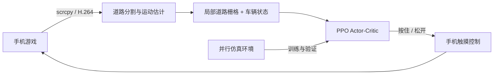

# 小鸡卡丁车 · PPO 自动驾驶

通过 ADB 连接安卓手机，让 PPO 模型玩支付宝蚂蚁庄园的小鸡卡丁车。模型从屏幕估计道路和车辆状态，只决定 **按住屏幕 / 松开屏幕**；车辆持续前进，目标是到达终点，并尽可能获得完美漂移。

当前权重已在真机上连续完成 **第646关、第647关** 各一次测试。它仍是实验模型，尚未证明多关稳定通关。

## 效果展示

| 模型决策 + 手机实际运行（外部设备拍摄） | GIF 速览 |
| --- | --- |
|  |  |

<!-- 视频就绪后，将上方第一张占位图换成视频封面链接：[](视频地址)。GitHub README 的视频也可以使用上传附件产生的链接。 -->
<!-- GIF 就绪后，将第二张占位图的路径替换为 docs/media/demo.gif。 -->

这里预留给后续拍摄的“模型决策画面 + 手机同步运动”，当前图片只是占位，不是运行截图。替换说明见 [媒体说明](docs/media/README.md)。

## 工作方式



- **感知**：传统视觉与运动估计生成 48×48 局部道路栅格和8维状态，不依赖独立的 RoadNet 模型。
- **决策**：CNN 编码道路、MLP 编码状态，输出两个动作的概率。训练时采样，真机部署选择概率更高的动作。
- **训练**：从随机权重开始的纯 PPO，不使用人工动作标签、模仿损失或人工动作一致性惩罚。
- **仿真**：共享物理内核覆盖漂移、输入延迟、坡道起跳和落地、整幅起伏及完美漂移；批量环境支持 GPU。
- **奖励**：推进和通关奖励、失败惩罚、完美漂移奖励；频繁切换动作不扣分。当前 ground_inset、landing_inset、margin、margin_jitter 均为0，完美漂移奖励为0.5，可在配置中调整。

## 快速开始：使用现有模型

运行环境为 Linux / WSL2 + Python 3.10 及以上。真机推理可使用 CPU；训练建议使用 NVIDIA GPU。

```bash
git clone https://github.com/JoeLoveSally/Ali-Manor-Karting-Agent.git
cd Ali-Manor-Karting-Agent
python3 -m venv .venv
source .venv/bin/activate
python -m pip install -r requirements.txt
```

如需 GPU 训练，请安装与本机驱动匹配的 CUDA 版 PyTorch，并确认 `torch.cuda.is_available()` 为真。当前发布权重在 PyTorch 2.9.1 + CUDA 12.8 的4060 Laptop上训练，真机端使用 CPU。

另外准备：

1. 安装 `adb` 与 **scrcpy 4.1**，加入 PATH。当前通信协议固定为4.1，匹配的 `scrcpy-server` 必须位于 scrcpy 可执行文件解析后的同一目录。
2. 开启手机 USB 调试并授权；WSL2 用户先将 USB 转发给 WSL。使用 `adb devices` 确认设备在线。
3. 打开游戏，停在卡丁车“出发”页，保持手机亮屏。

```bash
adb devices
python tools/drive.py models --checkpoint best.pt --serial YOUR_DEVICE_SERIAL --max-time 150
```

如手机已停在上一局结算页，加入 `--prepare`，程序识别页面后领取普通奖励并进入下一局：

```bash
python tools/drive.py models --checkpoint best.pt --serial YOUR_DEVICE_SERIAL --prepare --max-time 150
```

**每次执行只跑一局**，结束后停在结算页。记录保存在自动创建的 `runs/drive-时间戳/`，包括原始画面、帧时间、动作、模型副本和运行文件哈希。

当前视觉投影标定来自1440×3200竖屏设备，传输帧为720×1600；其他分辨率、画面布局或车型性能可能需要重新标定，不能仅缩放图片就假定适配。

## 从零训练

```bash
bash scripts/train.sh
```

默认256个并行环境、每轮64步、最多2000轮，输出到 `outputs/ppo-v2/`。可通过环境变量指定设备、环境数量、轮数与新输出目录：

```bash
DEVICE=cuda ENVS=256 ITERS=2000 OUT=outputs/my-run bash scripts/train.sh
```

脚本拒绝复用已有输出目录，以保证新实验从零开始。同一实验意外中断后，如需恢复，可按脚本中的相同参数直接调用 `python -m kart.ppo`，并添加 `--resume 输出目录/checkpoint.pt`；这与新实验导入旧权重不同。

训练场景按每次重置独立抽样：随机完整路线25%、第645关重建局部弯段15%、独立坡道30%、连续弯20%、整幅起伏10%。局部弯段是几何案例，不包含人工动作。坡道覆盖A/B方向、靠边起点、速度和延迟变化、部分完成的转向。

每50轮在七类固定验证集上评估部署动作，各128个场景；坡道按方向和空中输入候选分层。选优兼顾平均通过率、最弱类别和最弱坡道分组。达到候选资格后，至少训练1000轮，连续16次检查无足够提升才早停；否则到2000轮结束。独立测试集不参与选优。

单进程 PyTorch CUDA 分配器默认限制2 GiB，但这不包含全部 CUDA 上下文开销，也不是整机显卡的资源锁。共享显卡上请先确认剩余显存和其他训练占用；发布脚本不自动抢占或停止其他进程。

## 评测与可视化

评测工具要求一个名为 `baseline` 的对照。仅核验发布模型时，下面用同一权重作基线；因此不能用此命令证明相对提升。正式对比时替换 `baseline` 的模型路径。

```bash
python tools/eval_survival.py \
  --params configs/train-params.json --device cuda --envs 128 --seed 20261101 \
  --models baseline=models/best.pt best=models/best.pt \
  --suites standard16 long30 bends16 ramp relief middle16 level645 \
  --case configs/level645-case.json --robust-scenes --sampled-diagnostics \
  --out outputs/evaluation

python tools/collect_policy_replays.py \
  --evaluation outputs/evaluation --model models/best.pt \
  --params configs/train-params.json --device cuda --balanced \
  --out outputs/replays

python tools/render_policy_replays.py outputs/replays
```

最后一条命令会生成 HTML 回放与 MP4。渲染需要中文字体，默认使用系统的 `NotoSansCJK-Regular.ttc`，也可通过 `KART_FONT=/字体路径/字体文件` 指定。

真机录像导出和原始决策复算：

```bash
python tools/export_drive.py runs/drive-时间戳
python tools/replay_drive.py runs/drive-时间戳 --out outputs/phone-replay
```

复算使用已录制的画面和操作，验证重现性；它不是另一次闭环真机测试。

## 当前结果与边界

4060 Laptop上的本轮训练在第1500轮正常早停，主训练约 **3小时4分钟**，所选 best 来自第700轮。新种子独立测试共896个场景，通过802个（89.51%）。

| 仿真测试类别 | 通过 / 总数 |
| --- | ---: |
| 常规路线 | 108 / 128 |
| 长路线 | 102 / 128 |
| 密集连续弯 | 94 / 128 |
| 坡道 | 126 / 128 |
| 整幅起伏 | 128 / 128 |
| 中等长度连续弯 | 117 / 128 |
| 第645关重建局部弯段 | 127 / 128 |

真机已确认第646、647关各一次通关；第646关游戏计时42.15秒。两关使用同一份 best、飞车王IV Lv54、操控加成+92.7%。这是两次单局结果，不是随机关卡总体通过率。详细数值见 [结果记录](docs/results.json)。

尚有明确限制：

- 空中输入究竟锁向还是响应，现有证据未唯一确定。当前仿真每回合以各50%的概率覆盖这两种候选，模型不接收候选模式或高度真值。
- 完美漂移和加速机制仍是近似模型，未完成完整真机校准。
- 新 best 在部分独立仿真类别仍弱于历史参考，未达到“各类全面不退步”的晋级标准；本仓库附带的是可复现实验权重。
- 仿真通过不能替代真机验证，局部重建案例也不等于完整第645关地图。

## 目录

```text
kart/                  策略网络、PPO、仿真、视觉与手机通信
configs/               本轮训练参数、局部弯段几何
models/best.pt         本轮选中的策略权重
artifacts/             真机感知参数及必要图像模板
scripts/train.sh       从零训练入口
tools/                 评测、回放、渲染与单局真机运行
tests/                 PPO、仿真和评测回归测试
docs/results.json      本轮评测及真机结果摘要
docs/media/            待补充的外拍视频 / GIF 展示位
```

`configs/train-params.json` 用于本轮仿真训练；`artifacts/sim_params.json` 保留真机状态估计所用参数，两者用途不同。源码保留部分历史兼容接口，但上述训练入口强制启用纯 PPO，无人工动作约束。原始人类录像、完整实验目录、远程机器地址、设备序列号和旧模型不随发布版上传。

```bash
python -m pip install -r requirements-dev.txt
python -m pytest -q
```
